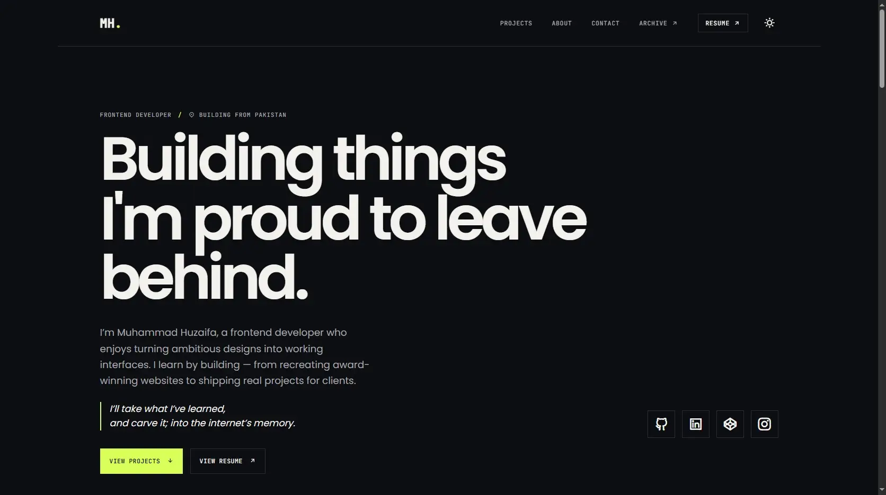

<div align="center">

# Portfolio V3

**A project-first frontend portfolio built to showcase my strongest work, document how I have grown as a developer, and give older experiments a place to live.**

Built with **HTML**, **CSS**, and **JavaScript** — without a frontend framework or build step.

[Live Portfolio](https://huzaifa-portfolio.pages.dev/) · [The Archive](https://huzaifa-portfolio.pages.dev/archive.html) · [GitHub](https://github.com/HuzaifaAkhtar2) · [LinkedIn](https://www.linkedin.com/in/muhammad-huzaifa24/)



</div>

---

## About the project

Portfolio V3 is my current personal portfolio and a complete rethink of how I want to present my work online.

Instead of turning the website into a copy of my resume, I designed it around the projects themselves: what I built, why I built it, what was difficult, how I approached the problem, and what I learned from the process.

The portfolio is split into two main ideas:

- **Featured Work** presents the projects I currently want visitors to judge me by.
- **The Archive** preserves the wider development journey — early websites, learning projects, recreations, UI exercises, portfolio iterations, small applications, and motion experiments.

The result is a portfolio that acts as both a professional showcase and a record of how my frontend skills have developed over time.

> **I'll take what I've learned... and carve it into the internet's memory.**

---

## Why I built Portfolio V3

My earlier portfolios were useful milestones, but I wanted this version to communicate more than a list of technologies and project links.

The main goals were to:

- make projects the main focus of the experience;
- build a visual identity that feels personal without becoming distracting;
- explain the thinking and lessons behind featured projects;
- separate current featured work from older learning projects;
- support both light and dark themes;
- make the site comfortable to use with a keyboard and on smaller screens;
- keep the implementation understandable and maintainable with web-platform fundamentals;
- avoid adding a framework simply because portfolios often use one.

This project therefore uses plain HTML, CSS, and JavaScript modules rather than React, Vue, or another frontend framework.

---

## Main features

### Project-first homepage

The homepage is designed around a small set of featured projects instead of an oversized list of everything I have ever built.

Project cards are rendered from JavaScript data and include:

- project status;
- project type;
- short descriptions;
- technology tags;
- tutorial attribution when applicable;
- project screenshots;
- detailed case-study dialogs.

The current featured set includes:

1. **Zentry.com Recreation** — a tutorial-based recreation that I later extended with additional sections, responsive work, and visual refinements.
2. **Britannia Restaurant Website** — a real client project focused on practical restaurant information, responsive layouts, and clear content hierarchy.
3. **Portfolio V3** — the portfolio itself, documented as a project with its goals, architecture, accessibility decisions, and lessons learned.

---

### Detailed project case studies

Selecting **Read more** on a featured project opens a native `<dialog>` containing a structured case study.

Depending on the project, a case study can include:

- overview;
- motivation;
- goals;
- key features;
- challenge;
- solution;
- lessons learned;
- key takeaways;
- focus areas;
- SEO considerations;
- accessibility considerations;
- architecture notes;
- client and role information;
- tutorial attribution;
- educational-recreation disclaimers;
- live-demo and GitHub links.

Keeping this information inside a dialog lets the homepage stay relatively compact while still giving interested visitors much more context.

---

## The Archive

**The Archive is where the journey lives.**

Not every useful project needs to compete for space on the homepage. The Archive keeps older, smaller, experimental, and learning-focused projects visible without presenting all of them as equally important.

The current Archive contains **38 projects** organized into:

- Apps & Games
- Recreations
- Websites
- Portfolios
- UI Components
- Motion Lab

It also contains several curated views:

### Archive Highlights

A smaller collection of projects that pushed me further in logic, interaction, responsive work, or visual experimentation.

The current highlight set contains:

- Portfolio Using Three.js
- Spotify Clone
- Scientific Calculator
- Weather App
- Tic-Tac-Toe
- Product Landing Page
- Neon Lab
- Sliding Image Track

### Where It Started

A dedicated section for the earliest projects that helped make web development feel possible to me.

These projects are kept for historical value even when they no longer represent my current technical ability.

### Portfolio Iterations

A timeline showing how my personal portfolio changed alongside my frontend skills and design taste.

### Filters

Visitors can filter the Archive without reloading the page. The project counts and screen-reader status text are updated dynamically as the active category changes.

---

## Hidden command interface

Portfolio V3 contains an optional terminal-style command interface as an easter egg.

On desktop it can be opened with:

```text
Ctrl + /
```

It can also be opened through the terminal button in the footer. On smaller screens the keyboard shortcut is replaced visually with a terminal icon.

Available commands include:

```text
/help
/home
/projects
/archive
/about
/contact
/resume
/whoami
/inventory
/achievements
/coffee
/secret
/theme
/clear
```

The interface supports:

- command history with the Up and Down arrow keys;
- simple command completion with Tab;
- navigation commands;
- theme switching;
- resume access;
- playful developer easter eggs;
- an optional local text-editing mode through `/secret`.

The secret editing mode only changes the current page in the browser. Refreshing the page restores the original content.

---

## Theme system

The site supports both **dark** and **light** themes.

The theme system:

- stores the selected theme in `localStorage`;
- applies the same preference across the homepage and Archive;
- updates the browser theme color;
- swaps between light and dark favicon variants on the main pages;
- uses shared CSS custom properties so both themes use the same component/layout rules.

The primary color system is defined in `css/utilities.css`.

---

## Responsive design

The portfolio is designed to adapt across desktop, tablet, and mobile layouts.

Responsive behavior includes:

- a desktop navigation bar that becomes a mobile menu;
- a two-column desktop hero that simplifies on smaller screens;
- responsive project-card grids;
- project case studies that collapse from two columns to one;
- responsive About and Contact layouts;
- Archive grids that progressively reduce their column count;
- mobile-friendly terminal sizing;
- buttons and navigation that remain usable at narrow widths;
- typography built with `clamp()` to scale between viewport sizes.

The layout is constrained to a maximum content width of `1440px` and uses fluid horizontal spacing with CSS `clamp()` values.

---

## Accessibility

Accessibility was treated as part of the implementation rather than an afterthought.

Current accessibility-related features include:

- semantic HTML landmarks and sections;
- a **Skip to content** link;
- keyboard-accessible navigation;
- visible `:focus-visible` states;
- native `<dialog>` elements for project details and the command interface;
- focus restoration after dialogs close;
- `aria-expanded` state on the mobile navigation button;
- `aria-current` for active navigation states;
- screen-reader-only labels where visual icons are used;
- an `aria-live` status region for Archive filtering;
- an `aria-live` status region for contact-form feedback;
- reduced-motion handling through `prefers-reduced-motion`;
- semantic form labels and browser validation;
- decorative icons and images hidden from assistive technology where appropriate.

---

## Contact form

The contact form is connected to **Web3Forms**.

It includes:

- required name, email, and message fields;
- native form validation;
- asynchronous submission with `fetch()`;
- loading feedback while the message is being sent;
- success and error messages;
- a bot-check field;
- a direct email link as an alternative contact method.

The form still contains a normal `action` and `method`, so the underlying HTML describes where the form should submit even though JavaScript enhances the experience.

If you fork this repository, replace the Web3Forms access key in `index.html` with your own key.

---

## SEO and social sharing

The site includes several search and sharing fundamentals:

- page-specific `<title>` values;
- meta descriptions;
- canonical URLs;
- Open Graph metadata;
- Twitter card metadata;
- a dedicated Open Graph preview image;
- JSON-LD structured data;
- `robots.txt`;
- `sitemap.xml`;
- `noindex` on the custom 404 page.

The homepage uses `Person` structured data, while The Archive uses `CollectionPage` structured data.

---

## Performance decisions

The portfolio intentionally avoids a heavy frontend stack.

Performance-oriented choices include:

- no frontend framework;
- no runtime package dependencies;
- no JavaScript bundler required for production;
- WebP project screenshots;
- lazy loading for project/archive images that are not immediately needed;
- locally hosted fonts and icons;
- small JavaScript modules separated by responsibility;
- CSS-driven interactions wherever JavaScript is unnecessary;
- reduced-motion handling;
- minimal third-party services — the contact form is the primary external service used by the site.

---

## Technology stack

### Core

- HTML5
- CSS3
- JavaScript (ES6 modules)

### Layout and interface

- CSS Grid
- Flexbox
- CSS custom properties
- responsive `clamp()` sizing
- native `<dialog>`
- Web Storage (`localStorage`)

### Services

- Web3Forms — contact-form delivery
- Cloudflare Pages — deployment

### Development tools

- Git
- GitHub
- VS Code
- Chrome DevTools

---

## Project architecture

The project deliberately uses a small static-site structure rather than splitting every component into its own folder or module.

```text
portfolio-v3/
│
├── assets/
│   ├── fonts/
│   │   ├── JetBrains Mono
│   │   ├── Poppins
│   │   ├── Remix Icon
│   │   └── LICENSES.md
│   ├── profile-picture.webp
│   ├── og-image.webp
│   └── project screenshots...
│
├── css/
│   ├── fonts.css
│   ├── utilities.css
│   ├── index.css
│   ├── archive.css
│   ├── terminal.css
│   └── 404.css
│
├── data/
│   ├── projects.js
│   └── archive-projects.js
│
├── docs/
│   ├── ARCHIVE_SPECS.md
│   ├── TERMINAL_SPECS.md
│   └── Muhammad_Huzaifa_Resume.pdf
│
├── favicon/
│   ├── light and dark favicon variants
│   └── site.webmanifest
│
├── js/
│   ├── index.js
│   ├── archive.js
│   ├── terminal.js
│   └── 404.js
│
├── index.html
├── archive.html
├── 404.html
├── robots.txt
├── sitemap.xml
├── LICENSE
├── NOTICE
└── README.md
```

### Why this structure?

Portfolio V3 is a relatively small static site. The project therefore favors a straightforward folder structure over a large component architecture designed for an application with hundreds of routes or features.

The main separation is by responsibility:

- **HTML** defines page structure.
- **CSS** handles shared styling and page-specific presentation.
- **data** files contain project content.
- **JavaScript** handles rendering and interaction.
- **assets** contain media, local fonts, and visual resources.

---

## JavaScript overview

### `js/index.js`

Controls the main portfolio page, including:

- featured-project rendering;
- project-case-study dialogs;
- tutorial attribution;
- theme switching;
- mobile navigation;
- active navigation state;
- scroll progress;
- contact-form submission;
- terminal initialization.

### `js/archive.js`

Controls The Archive, including:

- project rendering;
- category filters;
- Archive highlights;
- origin projects;
- portfolio timeline;
- UI Component and Motion Lab layouts;
- tutorial attribution;
- theme switching;
- mobile navigation;
- scroll progress;
- terminal initialization.

### `js/terminal.js`

Contains the reusable command-interface implementation shared by the homepage and Archive.

### `js/404.js`

Handles theme persistence and theme switching on the custom 404 page.

---

## Data-driven project content

Featured and archived projects are stored separately from the rendering logic.

### Featured projects

Featured project data lives in:

```text
data/projects.js
```

A project can contain fields such as:

```js
{
  id: "project-id",
  title: "Project title",
  shortTitle: "Short title",
  type: "Project type",
  category: "category",
  status: "Completed",
  statusTone: "completed",
  description: "Short project description",
  tech: ["HTML", "CSS", "JavaScript"],
  image: "assets/project.webp",
  overview: "...",
  motivation: "...",
  goals: ["..."],
  features: ["..."],
  challenge: "...",
  solution: "...",
  lessons: "...",
  takeaways: ["..."],
  github: "https://github.com/...",
  demo: "https://..."
}
```

The rendering code only displays sections whose data exists, so different projects can have different levels of case-study detail.

### Archive projects

Archive content lives in:

```text
data/archive-projects.js
```

Archive-specific properties include:

- `highlight` — includes the project in Archive Highlights;
- `origin` — marks an early project for the **Where It Started** section;
- `portfolioOrder` — positions a portfolio in the portfolio timeline;
- `isCurrent` — marks the current portfolio;
- `featuredOnHome` — indicates that a project is also featured on the main page;
- `tutorialBased`, `tutorialCreator`, and `tutorialUrl` — provide transparent attribution for guided projects.

This makes the Archive easy to extend without manually rewriting its HTML.

---

## Adding a featured project

1. Add the project screenshot to `assets/`.
2. Open `data/projects.js`.
3. Add a new project object.
4. Include the case-study fields that are relevant to the project.
5. Add the live demo and source links.
6. Reload the site — the card and project count are generated automatically.

---

## Adding a project to The Archive

1. Open `data/archive-projects.js`.
2. Add a new object to `archiveProjects`.
3. Assign one of the existing categories:
   - `app`
   - `recreation`
   - `website`
   - `portfolio`
   - `ui`
   - `motion`
4. Set optional properties such as `highlight`, `origin`, or `portfolioOrder` when appropriate.
5. Add tutorial attribution when the project was created from a tutorial or guided build.

The Archive renderer automatically places the project in the appropriate view.

---

## Running locally

There is no package installation or build process.

### 1. Clone the repository

```bash
git clone https://github.com/HuzaifaAkhtar2/portfolio-v3.git
cd portfolio-v3
```

### 2. Start a local server

Because the project uses JavaScript ES modules, serving it through a local HTTP server is preferable to opening `index.html` directly with `file://`.

Using Python:

```bash
python -m http.server 8000
```

Then open:

```text
http://localhost:8000
```

You can also use extensions such as **Live Server** in VS Code.

---

## Deployment

The production version is deployed on **Cloudflare Pages**:

**https://huzaifa-portfolio.pages.dev/**

Because the project is static, deployment does not require a build command. The repository contents can be served directly as static files.

If the production domain changes, update the URLs used in:

- canonical tags;
- Open Graph metadata;
- Twitter metadata;
- JSON-LD structured data;
- `robots.txt`;
- `sitemap.xml`.

---

## Tutorial projects and recreations

Some projects shown in the portfolio or Archive began as tutorials, guided builds, or recreations of existing websites.

I try to distinguish those projects clearly rather than presenting them as completely original concepts.

Where creator information has been confirmed, tutorial attribution is displayed directly in the interface and stored with the project data.

Recreations are educational projects and are not affiliated with or endorsed by the original brands unless explicitly stated otherwise.

---

## Development process and AI assistance

Parts of Portfolio V3's implementation and iteration were assisted by **OpenAI Codex** as a coding tool.

The project direction, portfolio concept, project selection, written content, design decisions, feature decisions, review process, and final integration were curated by me.

I treat AI tools as development assistance rather than a replacement for understanding the codebase, making design decisions, or taking responsibility for the final result.

---

## Fonts and icons

The project self-hosts its typography and icon assets.

- **Poppins** — SIL Open Font License 1.1
- **JetBrains Mono** — SIL Open Font License 1.1
- **Remix Icon** — Apache License 2.0

See `assets/fonts/LICENSES.md` for the included font/icon licensing notes.

---

## License

The source code is released under the **MIT License**.

Personal material associated with the portfolio — including branding, photographs, resume content, project screenshots, and written case-study content — is treated separately as described in `NOTICE` and should not be reused as another person's portfolio identity or work.

See:

- `LICENSE`
- `NOTICE`

for the repository's licensing terms and asset notice.

---

## Contact

**Muhammad Huzaifa**  
Frontend Developer

- Portfolio: https://huzaifa-portfolio.pages.dev/
- GitHub: https://github.com/HuzaifaAkhtar2
- LinkedIn: https://www.linkedin.com/in/muhammad-huzaifa24/
- Email: muhammad.huzaifa09@outlook.com

---

<div align="center">

**Designed & developed by Muhammad Huzaifa**

Built with HTML, CSS & JavaScript · Deployed on Cloudflare Pages

</div>
